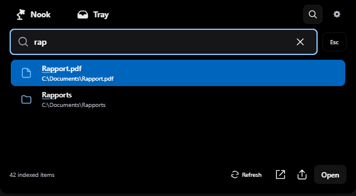
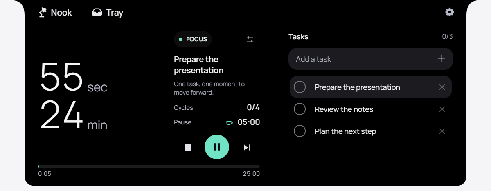

# Notchy V2

**Your day, a little closer.**

Music, focus and local files—right where you need them.

  

[Download for Windows](https://github.com/Darwin0-0/notchy-v2/releases/latest) · [Help improve Notchy](CONTRIBUTING.md) · [Report a bug](https://github.com/Darwin0-0/notchy-v2/issues/new)

**Meet Notchy in 28 seconds.** Music, focus and nearby sharing, in one quiet space.

https://github.com/user-attachments/assets/94bf59c0-2316-48e4-83d8-acb2e9363eca

[Watch or download the film](assets/previews/notchy-film.mp4)

Notchy is a compact notch for Windows. Click to open your controls. Move away and the notch settles into its discreet view. Its panel adapts to the modules you choose and the space they need.

Nook keeps the arrangement you choose, with your everyday essentials beside it. Open an activity for its detailed controls, then return to the same layout. Starting or pausing a focus session keeps your music in place.

On your first launch, Mimo wakes up, takes a curious look and welcomes you in. An optional quick guide helps you find your way; revisit it from Settings whenever you need a reminder. The installed app starts with Windows and stays discreet after setup. You can turn this off in Settings.

The project is actively evolving. Choose Français or English on the welcome screen or in Settings; the film and previews use sample data.

## Make room for what matters

- **Music within reach.** Notchy automatically follows compatible Windows media players, with artwork, playback controls, track progress and a softly animated spectrum. Everyday playback needs no personal API key. Add **Up next** with the optional Spotify connection.
- **One place for tasks and Pomodoro.** Keep your next task beside your session, work in focused intervals, and take a short or long break when it is time.
- **A panel for each moment.** Choose Focus, Ambience, Day, Complete or Minimal from Scenarios in Settings. Optional rules follow your work and breaks; manual choices and ongoing interactions stay protected.
- **Your day at a glance.** Read the weather, open detailed forecasts from the city, and keep appointments in a local calendar. Its icon changes color when you have something planned today.
- **Files ready to use.** Drop files into the Shelf, preview them, and open file actions such as OCR or conversion.
- **Ready to receive.** LocalSend starts with Notchy. Accept incoming files, send to nearby devices, and follow the transfer without leaving the notch.
- **Find it, keep your flow.** Open local search from the magnifying glass or **Ctrl+Space**. Find a file or folder by name, reveal it in Explorer, or choose a nearby device to send it with LocalSend. Your search stays on your PC.
- **Make space for your own ideas.** Browse the included module selection, preview three layouts, or import a local JSON module from **Settings → Modules → Library**. Your module data stays on this device.

[Watch the LocalSend scenarios](docs/LOCALSEND_SCENARIOS.md): discovery, sending, receiving and retrying, with sample files and devices.

## Start small, make it yours

1. [Download the Windows installer](https://github.com/Darwin0-0/notchy-v2/releases/latest) and run setup. No build tools are needed; setup downloads WebView2 if it is missing.
2. Hover over the notch for a quick preview, then click to open the controls. Move away to return to the discreet view. Keyboard editing, file dialogs and active drags stay protected while you use them.
3. Open **Settings → Modules** to arrange Music, Focus, Tasks, Weather and Shelf. Open **Tray** for files and LocalSend; save a copy to Downloads whenever you need one.
4. Choose your city, add a task and prepare a focus session. Set its duration before starting. To adjust an active session, pause it from its settings; saved changes keep the time already spent. Back or Escape cancels an unsaved change.
5. Use **Ctrl+Space** for local search. Navigate with the arrow keys, press **Enter** to open a result or **Ctrl+Enter** to reveal it, and **Escape** to return. If the global shortcut is busy, Notchy tries **Ctrl+Shift+Space**; **Ctrl+K** also works inside Notchy.

Your personal profiles and files stay in local data folders and are excluded from the source repository. Weather uses a public forecast service; Spotify is optional, and LocalSend connects devices on your local network. Setup and privacy details are in the [development guide](docs/DEVELOPMENT.md).

The [interaction guide](docs/INTERACTIONS.md) follows the complete paths from tasks to a focus session, detailed music controls, and local sharing.

## Build it with us

You do not need to know the whole codebase to make Notchy better. A clear bug report, a small fix or a thoughtful design observation is a useful place to start.

[Open an issue](https://github.com/Darwin0-0/notchy-v2/issues/new) with what you tried and what you expected, or read [CONTRIBUTING.md](CONTRIBUTING.md) to work on one focused improvement. Screenshots, keyboard-access feedback and reports from different display scales are welcome.

The [project backlog](docs/ROADMAP.md) lists the remaining decisions, release checks and product improvements, with a clear finish line for each.

Have an idea for a module? Start on the [blank island in the module SDK](sdk/README.md), then follow the [detailed JSON manifest reference](docs/MODULES.md). The same renderer powers the SDK and imported modules. The current library ships with Notchy; an online community marketplace is not connected yet.

## Architecture

Notchy has three main places: **Nook** for your activities, **Tray** for files and nearby sharing, and **Settings** for General, Modules, Scenarios and Health. Select an activity card to open its detailed controls; return to Nook without losing the current song, task or timer.

The Rust core owns native settings, network diagnostics, device discovery and file operations. The interface reuses those results and keeps its presentation separate from them. Shared [design tokens](docs/tokens.md) keep activity colors, status colors, type and motion consistent. LocalSend works on the same local network without internet; when automatic discovery is unavailable, add a private IP or use the explicit local-network search in Health.

[Local search](docs/LOCAL_SEARCH.md) is a utility available from every main view. It indexes file and folder names in your personal Windows libraries, with live updates and keyboard navigation. Document contents and application launching are outside this first version; hidden, private and offline locations are excluded.

Small contributions fit here: improve a real interaction, test an empty or error state, or help refine one module. The [development guide](docs/DEVELOPMENT.md) explains how to run and verify a change.

## Thanks, and licensing

Thanks to everyone who tests a build, reports a rough edge or shares an idea—and to the authors of the [third-party components](THIRD_PARTY_NOTICES.md) used here.

A project-wide licence has not been selected yet. Public availability does not add one; check the licensing status before reusing or redistributing the application code. Third-party licences remain in place.
