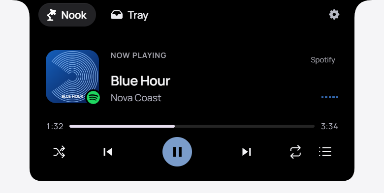

# Notchy V2

**Your day, a little closer.**

Music, tasks, weather and files—right where you need them.

  

[Get started](docs/DEVELOPMENT.md#build-and-run-on-windows) · [Help improve Notchy](CONTRIBUTING.md) · [Report a bug](https://github.com/Darwin0-0/notchy-v2/issues/new)

Notchy is a compact notch for Windows. Hover for a quick glance, open it for the controls, then get back to what you were doing. Its panel adapts to the modules you choose and the space they need.

Mimo greets you on first launch with an optional quick guide. You can revisit it from Settings whenever you need a reminder.

The project is actively evolving. Choose Français or English on the welcome screen or in Settings; the previews use sample data.

## Make room for what matters

- **Music within reach.** Artwork, playback controls, track progress and a spectrum that responds to real audio. Add **Up next** with the optional Spotify connection.
- **One place for tasks and Pomodoro.** Keep your next task beside your session, work in focused intervals, and take a short or long break when it is time.
- **Weather you can read at a glance.** A short forecast for your current location or a city you choose.
- **Files ready to use.** Drop files into the Shelf, preview them, and open file actions such as OCR or conversion.
- **LocalSend in Tray.** Accept incoming files, send to nearby devices, and follow the transfer without leaving the notch.

## Start small, make it yours

1. [Build and run Notchy](docs/DEVELOPMENT.md#build-and-run-on-windows) on Windows. A packaged download is not available yet.
2. Hover over the notch for a glance; click to open the full controls.
3. Right-click to arrange or remove Music, Focus, Weather and Shelf. Open **Tray** for files and LocalSend.
4. Choose your city, add a task and start a session. Settings stay open while you move between controls; the close button or Escape dismisses them.

Your personal profiles and files stay in local data folders and are excluded from the source repository. Weather uses a public forecast service; Spotify is optional, and LocalSend connects devices on your local network. Setup and privacy details are in the [development guide](docs/DEVELOPMENT.md).

## Build it with us

You do not need to know the whole codebase to make Notchy better. A clear bug report, a small fix or a thoughtful design observation is a useful place to start.

[Open an issue](https://github.com/Darwin0-0/notchy-v2/issues/new) with what you tried and what you expected, or read [CONTRIBUTING.md](CONTRIBUTING.md) to work on one focused improvement. Screenshots, keyboard-access feedback and reports from different display scales are welcome.

## What we are refining

- Everyday interactions: opening, hovering, resizing and dismissing the notch.
- The flow between tasks, focused work and breaks.
- Clearer feedback for file actions and LocalSend transfers.

These are areas for discussion and improvement, not delivery promises.

## Thanks, and licensing

Thanks to everyone who tests a build, reports a rough edge or shares an idea—and to the authors of the [third-party components](THIRD_PARTY_NOTICES.md) used here.

A project-wide licence has not been selected yet. Public availability does not add one; check the licensing status before reusing or redistributing the application code. Third-party licences remain in place.
